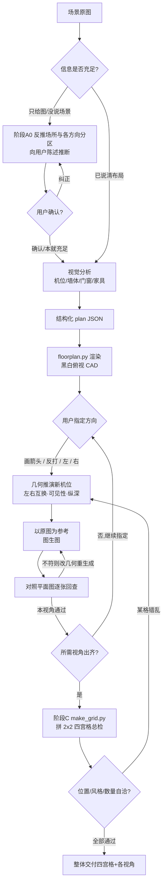

<div align="center">

# 场景视角规划器 · Scene View Planner

**只给一张图也能开工：先推断这是什么场景 → 标准俯视 CAD 平面图 → 按方向生成同一空间的反打 / 左侧 / 右侧 / 任意视角 → 四宫格总检位置与风格一致性**

[](LICENSE)


[](#-贡献-contributing)

**中文** ｜ <a href="#english">English</a>

</div>

---

## ✨ 这是什么

做 AI 漫剧、动态漫、解说漫、短剧、分镜或影视化的场景资产时，最头疼的是**同一个场景换个机位就"穿帮"**：左右物体对不上、生图模型很难根据图片场景想象出反打画面，导致创作者卡在场景资产创作无法推进下一步。

本项目把这件事变成一条**几何可追溯的闭环流水线**：

0. **阶段 A0（冷启动推断）**：你只发一张图、没多说信息时，先根据画面反推“这是什么场所的哪个功能分区、反打/左/右各应该是什么区”（例如一眼认出是咖啡店吧台制作区，反打应是顾客点单/座位区），**先向你陈述并等你确认**，不擅自开画；
1. **阶段 A（成图）**：分析场景图 → 抽象成结构化平面 JSON → 用脚本渲染出一张**标准黑白俯视 CAD 工程图**（不是让 AI 乱画示意图，方位严格可靠）；
2. **阶段 B（出视角）**：你在平面图上**画箭头**（箭头尖＝想看到的那面），或直接说“反打 / 左侧 / 右侧 / 转 X 度” → 几何推演出新机位与平面布局 → 以原图为参考生成**同一空间、同一光影材质**的新视角图，可反复指定；
3. **阶段 C（四宫格总检）**：所需视角出齐后，脚本自动拼一张固定机位顺序的 2×2 四宫格，统一核对位置关系有没有错乱、风格色调是否一致，有问题就改该视角再重拼。

> 它是一个标准 **Agent Skill（`SKILL.md` + `scripts/` + `references/`）**，遵循开放的 Agent Skills 目录规范，可被豆包、Claude（Claude Code / Desktop）、兼容该规范的客户端直接加载；脚本本身是纯 Python，也可单独命令行使用。


---

## 🖼️ 效果展示 Showcase

> 下列示例图均由本流程实际产出（AI 生成，仅作功能演示）。

### 案例 1 · 公共卫生间：原图 → 俯视平面 → 箭头指定 → 反打

| 场景原图 Original | 俯视 CAD 平面图 Floor plan |
|:---:|:---:|
|  |  |
| **在图上画箭头指定方向** Pick a view | **生成的反打视角** Reverse view |
|  |  |

### 案例 2 · 医院走廊（"="形长条空间）：一个场景补齐四个机位

长条空间最容易出错——**垂直看墙时被看墙应横向平展，只有沿走廊长轴看才有两侧向灭点汇聚**。下图严格区分了这两种透视：


四机位闭环（原视角 / 反打 / 左侧 / 右侧），注意反打时挂件左右正确互换：


### 案例 3 · 医院大院（U 形围合空间）：反打看身后的大门

U 形院落反打时，三栋楼全部转到身后、不入镜，画面主体是机位背后的医院大门——这类**围合空间的"谁在前方 / 谁在身后"判定**也已沉淀进规则：


### 阶段 C 自检：四宫格总览

所有视角出齐后，`make_grid.py` 按**固定机位顺序**（左上原视角 / 右上反打 / 左下左 / 右下右）拼一张四宫格，一眼看清位置关系与风格是否统一。下图中四格冷蓝色调一致、对角的原视角与反打左右正确互换、左右两格互为反向纵深，即判定自洽：


---

## 🧭 工作原理



**几条不可违反的几何铁律（也是本项目的核心价值）：**

- **箭头尖指向 ＝ 相机新朝向 ＝ 画面正前方看到的那面**；箭头是视线方向，不是相机移动方向。
- **反打必做左右互换**：平面点绕场景中心旋转 180°，`(x,y) → (2Cx−x, 2Cy−y)`，原左变新右、原右变新左。
- **长条空间先判透视类型**：视线垂直长墙 → 被看墙横向平展、无侧墙汇聚；视线沿长轴 → 两侧墙才向灭点汇聚。
- **围合空间先判前后**：落在新机位后向半球的建筑一律不画，避免"反打还看到原尽头主楼"。
- **画面外信息不编造**：机位背后拍不到的区域只能来自用户补充或原图可合理延伸，缺失先问。

---

## 📦 安装 Installation

需要 Python 3.9+：`floorplan.py` 依赖 matplotlib（会自动带上 numpy），`make_grid.py` 依赖 Pillow：

```bash
git clone https://github.com/EdwinZDZ/scene-view-planner.git
cd scene-view-planner
pip install -r requirements.txt
```

脚本会自动挑选系统中文字体（Windows / macOS / Linux 均已做回退），中文标注不会变方块。

---

## 🚀 使用教程 Usage

### 方式一：作为 Agent Skill 加载（推荐）

本目录本身就是一个合法 Skill：

- **豆包 / Claude Code / Claude Desktop 或兼容 Agent Skills 规范的客户端**：把整个 `scene-view-planner/` 目录放进其 skills 目录（如 Claude Code 的 `~/.claude/skills/`），随后直接对 Agent 发场景图即可，它会按 `SKILL.md` 自动走完 A0→A→B→C 完整闭环。
- **ChatGPT（自定义 GPT）**：把 `SKILL.md` 与 `references/` 内容贴入 Instructions / Knowledge，并把 `scripts/floorplan.py` 上传到 Knowledge，勾选 Code Interpreter。详细迁移步骤见 [SKILL.md](SKILL.md) 顶部说明与 `references/`。

### 方式二：单独用脚本出俯视 CAD

1. 参照下方 [plan JSON 速查](#-plan-json-速查) 或 [`references/cad_symbols.md`](references/cad_symbols.md)，把空间写成 `plan.json`；
2. 运行：

```bash
# 生成黑白俯视 PNG（可同时导出 SVG 矢量图）
python scripts/floorplan.py plan.json -o floorplan.png --svg floorplan.svg

# 用户确定方向后，叠加一个红色箭头做机位自检（x,y,方向）
python scripts/floorplan.py plan.json -o marked.png --arrow 3,3.4,S
```

3. 把 `floorplan.png` 交给任意图生图模型，按 [`references/camera_geometry.md`](references/camera_geometry.md) 第 6 节的五段提示词模板生成新视角。

### 阶段 A0：冷启动——只给一张图时，先推断再确认

当你只发图、没说明这是什么地方时，Agent **不会直接画平面图**，而是先按 [`references/scene_inference.md`](references/scene_inference.md) 做三步反推并向你确认：

1. **识别场所与当前分区**：从设备家具、标识、材质、采光取证（咖啡机+磨豆机+菜单黑板 → 咖啡店吧台制作区）；
2. **推断四方向分区**：以镜头朝向为前，预判正前方 / 反打 / 左侧 / 右侧 / 画面外各是什么区（如咖啡店反打应是点单取餐与堂食座位区）；
3. **陈述并等你确认**：明确区分"画面看到的事实"与"经验推断"，**你确认或纠正后才进入阶段 A**。这样画面外布局在动手前就对齐，避免反打凭空编造。

### 阶段 A：把场景图变成平面图

1. **读图**：定原机位位置与视线方向、空间轮廓与长宽比、各面墙上的门窗与固定物、主要家具沿墙位置；
2. **补画面外信息**：用户说"对面是墙还有一道门""背后是大门"等务必纳入，没说又影响目标视角时先问；
3. **写 plan JSON**：北朝上、x 东 y 北，只要求相对比例与拓扑正确，不要求真实尺寸；
4. **渲染并回读**：必须实际打开输出 PNG，对照原图核对机位、门所在墙、左右排布，不对就改 JSON 重渲染。

### 阶段 B：指定方向生成新视角

口头方向换算（原朝向 F0，北朝上）：

| 原朝向 F0 | 反打 180° | 左侧视角 | 右侧视角 |
|---|---|---|---|
| N | S | E | W |
| E | W | S | N |
| S | N | W | E |
| W | E | N | S |

生成前先在平面图上"站到新机位"列清：正中尽头是什么、新左右各是什么、谁进出画面、纵深与遮挡顺序；随后用五段模板组织提示词（**空间风格锚点 → 新机位 → 画面布局 → 反打/侧视几何关系 → 一致性约束**），以**原始场景图为首要参考**，只转机位、不重新装修。完整模板与实例见 [`references/camera_geometry.md`](references/camera_geometry.md)。

### 阶段 C：视角出齐后拼四宫格总检

反打 / 左 / 右都生成完，运行（纯 Pillow）：

```bash
python scripts/make_grid.py --front 原图.png --reverse 反打.png \
       --left 左侧.png --right 右侧.png -o grid.png
```

固定排布为「左上原视角 · 右上反打 · 左下左 · 右下右」，随后按三项清单核对：① **位置关系**（相邻 90° 边缘衔接、对角 180° 左右互换且不见同一尽头、左右两格互为反向纵深）；② **风格统一**（色温/材质/光照/视高焦段一致）；③ **数量一致**（门窗固定物跨视角对得上）。某格出错就回阶段 B 改该视角并重拼，直到四格自洽。详见 [`references/camera_geometry.md`](references/camera_geometry.md) 第 8 节。

---

## 🧱 plan JSON 速查

```jsonc
{
  "style": {"wall": 3.0, "inner": 2.0, "item": 1.8, "compass": true},
  "room":  {"bounds": {"xmin": 0, "ymin": 0, "xmax": 6, "ymax": 8}}, // 异形用 "outline":[[x,y]...]
  "openings": [
    {"kind": "door", "wall": "S", "at": 3.0, "width": 1.1, "hinge": "start"}
  ],
  "elements": [
    {"type": "stall_row", "x": 1.8, "y": 8.0, "n": 3, "cell_w": 0.9,
     "depth": 1.5, "orient": "S", "toilet": true},
    {"type": "sink_row", "wall": "E", "x": 5.55, "y0": 2.1,
     "n": 4, "pitch": 0.85, "w": 0.55, "d": 0.62}
  ],
  "camera": {"x": 3.0, "y": 0.7, "facing": "N", "label": "原机位"}
}
```

- `openings.kind`：`door / slide / opening / window / double`；`wall`：`N/S/E/W`。
- `elements[].type`：`wall`、`rect`、`circle`、`label`、`toilet`、`sink`、`stall_row`、`sink_row`、`counter`、`arrow`、`camera`。
- 未内置的物体一律用 `rect / circle / wall` 组合成俯视外轮廓近似。**完整字段、参数与更多示例见 [`references/cad_symbols.md`](references/cad_symbols.md)。**

---

## 📁 目录结构

```
scene-view-planner/
├── SKILL.md                     # Agent 主指令：A0/A/B/C 闭环 + 铁律
├── scripts/
│   ├── floorplan.py             # plan JSON → 黑白俯视 CAD（PNG/SVG/红箭头）
│   └── make_grid.py             # 多视角 → 固定顺序 2×2 四宫格（阶段C自检）
├── references/
│   ├── scene_inference.md       # 阶段A0 场景反推三步法 + 空间先验库 + 确认模板
│   ├── cad_symbols.md           # 透视图反推平面 + 全部图块字典
│   └── camera_geometry.md       # 机位几何推演 + 提示词模板 + 四宫格自检清单
├── examples/                    # 三个真实案例（原图/平面/箭头/各视角）
│   ├── bathroom/
│   ├── corridor312/
│   └── courtyard/
├── docs/images/                 # README 用的流程、对比与四宫格展示图
├── requirements.txt
└── LICENSE
```

---

## 🤝 贡献 Contributing

欢迎提交 Issue（错误机位案例尤其欢迎，这是规则迭代的最佳来源）与 PR：新增图块类型、补充 `references/` 里的空间类型判据、增加示例、完善英文版本文档都非常欢迎。提交前请确保 `python scripts/floorplan.py` 能正常渲染、且不破坏既有示例。

## 📄 许可证 License

[MIT](LICENSE)。示例图像由 AI 生成，仅用于功能演示。

---
---

<a id="english"></a>

# 🌐 English

# Scene View Planner

**Turn one scene photo into a standard top-down CAD floor plan, then render the reverse / left / right / any-angle view of the *same* space on demand.**

[](LICENSE)


## What it does

When building AI comics, motion comics, short films or storyboards, the hardest part is keeping a space **consistent across camera moves** — objects swap sides incorrectly, a reverse shot shows the wrong wall, or a corridor turns into a weird "bulge". This project turns it into a **geometrically traceable closed loop**:

0. **Stage A0 (cold-start inference)** — when you send only one photo with no extra info, the agent first infers the venue and current functional zone (e.g. a café's bar/prep area) and predicts what the reverse/left/right directions should contain (customer counter, seating area…), then **states this guess and waits for your confirmation** before drawing anything.
1. **Stage A** — analyze the scene photo, abstract it into a structured plan JSON, and render a clean **black-and-white top-down CAD plan** with a script (not an AI sketch — the orientation is reliable).
2. **Stage B** — you **draw an arrow** on the plan (arrow tip = the side you want to see) or say "reverse / left / right / rotate X°"; the agent geometrically derives the new camera and generates a new view of the **same space with identical lighting and materials**, using your original photo as reference. Repeatable for any direction.
3. **Stage C (grid self-check)** — once all needed views exist, a script assembles a fixed-layout 2×2 grid to verify camera relationships and visual consistency at a glance; any faulty cell is regenerated and the grid rebuilt.

One floor plan can be reused for as many camera directions as you need.

It ships as a standard **Agent Skill** (`SKILL.md` + `scripts/` + `references/`) following the open Agent Skills folder convention, while the renderer is plain Python you can also run standalone.


## Showcase

**Hospital corridor — four camera setups of one "=" shaped space.** A view *perpendicular* to the long wall stays flat and horizontal; only a view *along* the axis converges to a vanishing point.


**U-shaped courtyard — a reverse shot faces the main gate behind the camera.** All three buildings stay *behind* the new camera and leave the frame; the gate becomes the subject.


More per-step images are under [`examples/`](examples/) (`bathroom/`, `corridor312/`, `courtyard/`).

## Core geometric rules

- **Arrow-tip direction = new camera facing = what is seen straight ahead.** It is a viewing direction, not a movement.
- **Reverse shot always swaps left/right**: rotate 180° around the center, `(x,y) → (2Cx−x, 2Cy−y)`.
- **Long & narrow spaces**: perpendicular-to-wall views stay flat with no converging side walls; along-the-axis views converge.
- **Enclosed (U/L-shaped) spaces**: decide per object whether it is in front of or behind the new camera; anything in the rear hemisphere is dropped.
- **Never invent off-camera layout** — use only user-supplied info or reasonable extension of the original; when only a photo is given, Stage A0 infers the zones and asks for confirmation first.
- **Cold-start gate**: with no venue/context supplied, infer and confirm the scene type and off-screen zones *before* rendering the plan.
- **Final 2×2 grid self-check**: after all views are done, assemble them (front / reverse / left / right) and re-verify geometry, style and object counts as a whole.

## Install

```bash
git clone https://github.com/EdwinZDZ/scene-view-planner.git
cd scene-view-planner
pip install -r requirements.txt   # Python 3.9+, matplotlib(+numpy) for CAD, Pillow for the grid
```

A CJK font is auto-selected on Windows / macOS / Linux, so Chinese labels render correctly.

## Usage

**As an Agent Skill (recommended):** drop the whole folder into your runtime's skills directory (e.g. `~/.claude/skills/` for Claude Code); compatible agents then follow `SKILL.md` automatically. For a ChatGPT custom GPT, paste `SKILL.md` + `references/` into Instructions/Knowledge, upload `scripts/floorplan.py` to Knowledge, and enable Code Interpreter.

**Standalone rendering:**

```bash
python scripts/floorplan.py plan.json -o floorplan.png --svg floorplan.svg
python scripts/floorplan.py plan.json -o marked.png --arrow 3,3.4,S   # overlay a red arrow
# Stage C: stitch all views into a fixed-layout 2x2 self-check grid
python scripts/make_grid.py --front f.png --reverse r.png --left l.png --right r2.png -o grid.png
```

With only a photo and no context, Stage A0 first infers the venue/zones and asks you to confirm before the plan is drawn (see `references/scene_inference.md`). After every view is generated, Stage C rebuilds the 2×2 grid and checks camera geometry, style and object counts together (see section 8 of `references/camera_geometry.md`).

Verbal direction map (original facing F0):

| F0 | Reverse 180° | Left | Right |
|---|---|---|---|
| N | S | E | W |
| E | W | S | N |
| S | N | W | E |
| W | E | N | S |

See [`references/cad_symbols.md`](references/cad_symbols.md) for the full plan-JSON schema/block catalog and [`references/camera_geometry.md`](references/camera_geometry.md) for visibility reasoning and the five-part image-to-image prompt template.

## Layout

```
scene-view-planner/
├── SKILL.md                 # main agent instructions (A0/A/B/C loop + rules)
├── scripts/
│   ├── floorplan.py         # plan JSON -> top-down CAD (PNG/SVG/arrow)
│   └── make_grid.py         # views -> fixed 2x2 self-check grid (Stage C)
├── references/
│   ├── scene_inference.md   # Stage A0 scene inference + venue prior library
│   ├── cad_symbols.md       # block catalog / plan-JSON schema
│   └── camera_geometry.md   # camera reasoning + prompt template + grid checklist
├── examples/                # three real worked cases
└── docs/images/             # diagrams used by this README
```

## Contributing & License

Issues (especially wrong-camera cases) and PRs are welcome — new block types, more space-type rules in `references/`, new examples, and English docs. Released under the [MIT License](LICENSE). Example images are AI-generated and used for demonstration only.
